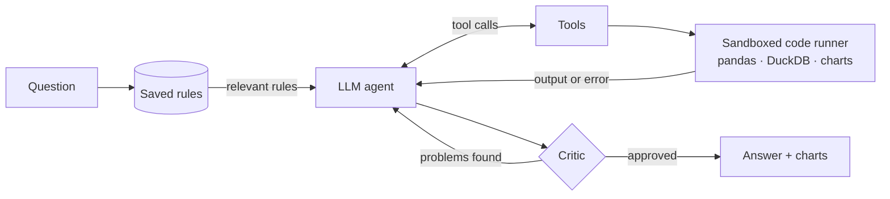

# AI Data Analysis Agent

**Ask questions about a CSV or Excel file in plain English. The agent explores the data, writes and runs pandas/SQL code, draws charts, explains *why* numbers changed, and checks its own work before answering.**

[](https://vnandhan-data-agent.streamlit.app/)


<!-- Add a short screen recording here: docs/demo.gif -->
<!--  -->

---

## What it can do

| | Feature | Example |
|---|---|---|
| 💬 | **Plain-English analysis** | *"Which vehicle type has the highest average booking value?"* |
| 📈 | **Charts** (Plotly, Matplotlib, Altair), checked so they're never empty | *"Stacked area chart of Movies vs TV Shows per year"* |
| 🧹 | **Data cleaning** with one-click undo | *"Drop rows where Booking Value is missing"* |
| 🔗 | **Multiple files & joins** — upload several tables; the agent finds join keys and merges them | *"Join the rides with the vehicle prices; which category has most completed rides?"* |
| 🔍 | **Root-cause finder** — which segments drove a change | *"Why did revenue drop from March to April?"* |
| 📐 | **Stats tools** — correlations, outliers, trend significance and forecasts with a 95% range and a backtest | *"Is booking value growing?"* · *"Forecast the next 2 weeks"* |
| 📋 | **One-click auto report** — overview, statistics, 2 charts, key insights, drivers (2–4 min on free tiers) | **Analyze this dataset** button |
| 🧐 | **Critic agent** — a second LLM reviews every answer and the agent fixes problems | Catches wrong numbers and unsupported claims |
| ❓ | **Asks when unclear** — instead of guessing between columns or definitions, it asks you (with one-click options) and can remember your answer | *"Average rating?"* → *"Driver Ratings or Customer Rating?"* |
| 🧠 | **Learning memory** — rules you teach it are applied to related questions | `remember: revenue = Booking Value of completed rides only` |
| 📝 | **Plan first** — bigger, multi-part requests get a short written plan before any tool runs; the critic checks every step was done | *"Compare Movies and TV Shows: counts, top rating of each, and a chart"* |
| 🔧 | **Live steps** — watch each tool call and its code as it happens | Expand **Agent steps** |
| 📄 | **Export** — the whole session as an interactive HTML report | **Download report** in the sidebar |
| 🔌 | **Switch models** — Groq, Google Gemini or Hugging Face from the sidebar | `gpt-oss-120b`, `gemini-3.5-flash`, Llama… |

## Work Flow



The LLM works in a loop with its tools (plus `ask_user` for clarifying questions). Every tool returns plain text, and if code fails the error goes back to the agent so it can **fix its own code and retry** (up to 4 times).

| Tool | What it does |
|---|---|
| `inspect_data` | Columns, types, nulls, sample rows, or details for one column; with several datasets it also suggests join keys (shared columns, % of values that match, one-to-many or many-to-many) |
| `run_analysis` | Runs pandas or DuckDB SQL code (joins across datasets included) and reads the printed result |
| `make_chart` | Builds a chart and checks it actually contains data |
| `update_dataset` | Cleans or transforms a dataset, or saves a new one (e.g. a joined table); later steps see the new version |
| `explain_change` | Breaks a metric's change between two periods/groups down by every column and ranks the segments that caused it |
| `stats_check` | Correlations (with p-values), IQR outliers, trend with significance test, and a forecast (linear trend + seasonality, 95% range, backtest); incomplete first/last periods are left out automatically |

**Root-cause finder.** For a sum, count or average compared between group A and group B, every other column is split into segments and each segment's contribution is computed (contributions add up exactly to the total change). Segments are ranked by their *unexpected* change — the part their size alone doesn't explain — so a segment isn't blamed just for being big. For averages the change is split into a rate effect (the segment's own average moved) and a mix effect (rows shifted towards it).

**Critic.** After the agent answers, a second LLM call gets the question, every step's code and output, and the answer. It checks that the code answers the question, every number comes from a tool output, nothing is overclaimed, and saved rules were followed. If it finds a problem, the agent gets one chance to fix it. It can be switched off in the sidebar (the one-click auto report skips it to stay fast on free tiers).

**Learning memory.** Rules are stored with a Gemini embedding; before each question the most similar ones (cosine ≥ 0.6, top 3) are given to the agent. Without a Gemini key a word-overlap match is used instead.

## Evaluation

21 test questions on the three sample datasets, each with an expected answer computed directly with pandas — lookups, group-bys, filters, percentages, charts, cleaning, root-cause and saved-rule questions. Answers are graded automatically (numbers within 1%, required words, chart made, data reshaped correctly, right tool used).

| Model | Critic | Correct | Avg. time |
|---|---|---|---|
| `openai/gpt-oss-120b` (Groq) | off | **21 / 21** | 25 s |
| `openai/gpt-oss-20b` (Groq) | off / on | **27 / 27** run so far | 34–42 s |

```bash
python eval/run_eval.py                                   # run (resumes where it stopped)
python eval/run_eval.py --models groq:openai/gpt-oss-20b gemini:gemini-3.5-flash --critic both
```

Results: [`eval/results/summary.md`](eval/results/summary.md).

## Run it locally

```bash
git clone https://github.com/vnandhan28/Automated_Data_Analysis_Agent.git
cd Automated_Data_Analysis_Agent
python -m venv .venv
.venv\Scripts\activate            # macOS/Linux: source .venv/bin/activate
pip install -r requirements.txt
streamlit run app.py
```

Create `.streamlit/secrets.toml` and fill in at least one API key (Groq and Gemini both have free tiers):

```toml
PROVIDER = "groq"               # "groq", "gemini" or "hf"
MODEL = "openai/gpt-oss-120b"   # default model for that provider

GROQ_key = "gsk_..."            # https://console.groq.com/keys
GEMINI_key = ""                 # https://aistudio.google.com/apikey (also used for memory embeddings)
HF_key = ""                     # https://huggingface.co/settings/tokens

SAVE_MEMORY = true              # keep saved rules on disk (leave out on a public deployment)
```

Then pick a sample dataset (cancer risk factors, Netflix titles, Uber bookings, or Uber bookings + a small vehicle price table to try joins) or upload one or more files of your own. `vehicle_types.csv` is a made-up companion table for the join demo.

## Project structure

```
app.py              Streamlit interface: chat, live steps, sidebar, export
langchain_agent.py  The agent: tools, fix-and-retry loop, critic, providers
AgentClass.py       Safety checks and the sandboxed code runner
rootcause.py        Root-cause breakdown (plain pandas)
stats.py            Correlations, outliers, trend and forecast (pandas + numpy)
memory.py           Saved rules and their retrieval
report.py           HTML report export
eval/               Test questions, runner and results
```

## Safety

Agent-written code is checked before it runs: no imports, no file/OS/network access, no internal (`_`) attributes, no access to environment variables or secrets, and DuckDB runs with external access switched off. Each tool works on a copy of the data, and the original files are never modified. On the public demo, saved rules last for one session only, so visitors can't influence each other's answers.

In-process Python is never a perfect sandbox, so for a public deployment use free-tier API keys without billing attached.

## Built with

Python · Streamlit · LangChain / LangGraph · pandas · DuckDB · Plotly · Altair · Matplotlib · Groq · Google Gemini
